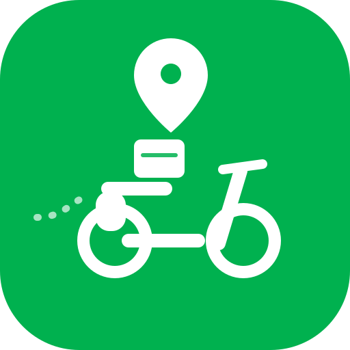

# Grab for Home Assistant



[](https://hacs.xyz)
[](https://github.com/realkibou/grab-for-home-assistant/releases)
[](https://creativecommons.org/licenses/by-nc/4.0/)

Turn a **Grab share link** ("Track my order" message) into live Home Assistant
sensors: booking state, ETA, driver, vehicle, pickup/drop-off and status
message — plus a *driver approaching* binary sensor you can automate on.

Setup asks you nothing: adding the integration instantly provisions a **Grab**
dashboard in the sidebar (icon `mdi:moped`) with a text box where you paste the
share link.

> ⚠️ **HACS is not accessible via Settings → Marketplace.** HACS lives in the
> Home Assistant **sidebar** (the HACS entry). Use that to add this repository.

> **Unofficial.** Not affiliated with, endorsed by or supported by Grab. It
> uses the same public share-tracking endpoint as
> `sharelocation.grab.com`. Grab may change it at any time.

---

## Features

- **Zero-question setup** – adding the integration asks for nothing
- **Auto dashboard** – a *Grab* sidebar dashboard (`mdi:moped`) with a
  **Share message** text box and all order details; created on install
- **Live polling** – booking details refresh every 30 s by default (configurable)
- **Native sensors** – booking state, booking code, route ETA, driver arrival,
  driver name, vehicle model/plate, pickup/drop-off, status title/message,
  pending delivery
- **Driver approaching binary sensor** – on when the ETA is within a
  configurable window (default 5 minutes)
- **`grab_link.set_share_message` service** – swap the tracked order from an
  automation or script
- **Diagnostics** – downloadable redacted diagnostics for troubleshooting
- **HACS ready** – validated by hassfest and the HACS action

## Requirements

- Home Assistant **2024.11** or newer
- A Grab share link (`https://app.grab.com/s/...`), e.g. from the
  "Track my order" message in Grab / WhatsApp / Telegram
- Internet access from Home Assistant

## Installation

### HACS (recommended)

1. Open **HACS from the Home Assistant sidebar** (not Settings → Marketplace).
2. Go to **Integrations**.
3. Open the menu (⋮) → **Custom repositories**.
4. Add `https://github.com/realkibou/grab-for-home-assistant` with category
   **Integration**.
5. Search for **Grab for Home Assistant** and choose **Download**.
6. **Restart Home Assistant**.

### Manual

Copy the `custom_components/grab_link` folder into your Home Assistant
`config/custom_components/` directory and restart Home Assistant.

## Getting started

1. Go to **Settings → Devices & services → Add integration** and pick
   **Grab for Home Assistant**. There is nothing to fill in — the entry is
   created immediately and a **Grab** dashboard appears in the sidebar.
2. Open the **Grab** dashboard.
3. Paste the Grab share message or just the `https://app.grab.com/s/...` link
   into the **Share message** text box and press Enter.
4. The sensors fill in within a few seconds. Paste a new link there whenever
   you have a new order.

The share link is stored in the config entry, so it survives restarts.

### Options

Open the integration entry and choose **Configure**:

| Option | Default | Range | Description |
| --- | --- | --- | --- |
| Update interval | 30 s | 10–3600 s | How often booking details are polled from Grab |
| Driver approaching window | 300 s | 30–1800 s | How close (in seconds) the ETA must be for `driver_approaching` to turn on |

## Updating the tracked order

Paste the new link into the **Share message** text box on the Grab dashboard,
or call the `grab_link.set_share_message` service:

```yaml
action: grab_link.set_share_message
target:
  entity_id: text.grab_link_share_message
data:
  message: "https://app.grab.com/s/QN3E7Rna"
```

If no target is given, **all** Grab for Home Assistant entries are updated.

### Example: track whatever is in a helper

Create an `input_text` helper (e.g. `input_text.grab_share_message`), paste new
links into it, and let an automation push them to the integration:

```yaml
alias: Track new Grab order
triggers:
  - trigger: state
    entity_id: input_text.grab_share_message
    not_to:
      - unknown
      - unavailable
      - ""
actions:
  - action: grab_link.set_share_message
    data:
      message: "{{ states('input_text.grab_share_message') }}"
```

## Entities

The device is named **Grab Link** (the config entry title), so the entity IDs
below assume you keep that name.

| Entity | Description |
| --- | --- |
| `text.grab_link_share_message` | Text box holding the tracked share link |
| `sensor.grab_link_booking` | Booking state (e.g. `ONGOING`); all details as attributes |
| `sensor.grab_link_booking_code` | Grab booking code |
| `sensor.grab_link_route_eta` | Route ETA (timestamp) |
| `sensor.grab_link_driver_arrival` | Driver arrival time (timestamp) |
| `sensor.grab_link_driver_name` | Driver name |
| `sensor.grab_link_order_from` | Pickup location |
| `sensor.grab_link_order_to` | Drop-off location |
| `sensor.grab_link_title` | Status title |
| `sensor.grab_link_message` | Status message |
| `sensor.grab_link_pending_delivery` | Pending delivery flag |
| `sensor.grab_link_vehicle_model` | Vehicle model |
| `sensor.grab_link_vehicle_plate` | Vehicle plate number |
| `binary_sensor.grab_link_driver_approaching` | On when the ETA is inside the approach window |

### Attributes of `sensor.grab_link_booking`

`booking_state`, `booking_code`, `booking_id`, `share_url`,
`driver_arrival_utc`, `route_eta_unix`, `title`, `message`,
`is_pending_delivery`, `driver_name`, `vehicle_model`, `vehicle_plate`,
`pickup`, `dropoff`

These names match the original YAML-based setup, so existing template sensors
and dashboards that read attributes from `sensor.grab_link_booking` keep
working.

## The Grab dashboard

The integration creates a storage dashboard at `/grab` with a *sections* view:

- **Grab Link** – share message text box, booking state, driver, order
  from/to, route ETA, driver arrival, message, title
- **Driver & Vehicle** – vehicle model/plate, booking code, driver approaching
- **Delivery** – pending delivery flag

You can rearrange and extend it freely; the integration only creates the
dashboard when it does not exist. If you delete it, it is recreated on the next
start.

## Examples

### Notify when the driver is approaching

```yaml
alias: Grab driver approaching
triggers:
  - trigger: state
    entity_id: binary_sensor.grab_link_driver_approaching
    to: "on"
actions:
  - action: notify.mobile_app_your_phone
    data:
      title: Grab
      message: >-
        {{ state_attr('sensor.grab_link_booking', 'driver_name') | default('Your driver', true) }}
        is arriving in about
        {{ ((state_attr('sensor.grab_link_booking', 'route_eta_unix') | int(0) - now().timestamp()) / 60) | round(0) }}
        minutes.
```

## How it works

1. The share message is scanned for a `https://app.grab.com/s/...` link.
2. The short link is resolved (single request, redirect headers only) to extract
   the booking ID from the `shareOrderLink` parameter.
3. Booking details are fetched from
   `https://api.grab.com/api/v1/safety/sharemyride/<booking_id>/bookingdetails`.

The booking ID is resolved once per link and reused for polling, so the short
link is not requested every cycle.

## Troubleshooting

Enable debug logging:

```yaml
logger:
  logs:
    custom_components.grab_link: debug
```

Common situations:

- **Errors in the log after the delivery finishes** – the Grab share endpoint
  stops returning details for completed/expired orders. Paste the next order's
  link into the Share message box.
- **Sensors show `unknown`** – no link is configured yet; paste one on the
  Grab dashboard.
- **Invalid link rejected in the text box** – the text must contain a
  `https://app.grab.com/s/...` link.
- **Rate limiting** – keep the update interval sensible (30 s is plenty). Very
  aggressive polling may get your IP throttled by Grab.
- **Diagnostics** – use **Download diagnostics** on the integration entry for
  redacted state when reporting a bug.

## Legacy YAML setup

The original `command_line` + template sensor approach (including the bash
script) is preserved in [`legacy/`](legacy/README.md) for reference and for
anyone who prefers the old method.

## License

Licensed under
[Creative Commons Attribution-NonCommercial 4.0 International (CC BY-NC 4.0)](https://creativecommons.org/licenses/by-nc/4.0/).

You are free to use and modify this project **for non-commercial purposes**.
Credit the author (realkibou) and link back to this repository. Commercial use
is not permitted.

## Disclaimer

This is a personal, unofficial project. Grab's API is undocumented and may
change or be restricted at any time; polling too aggressively may be rate
limited. Use at your own risk. Not affiliated with Grab Holdings.
